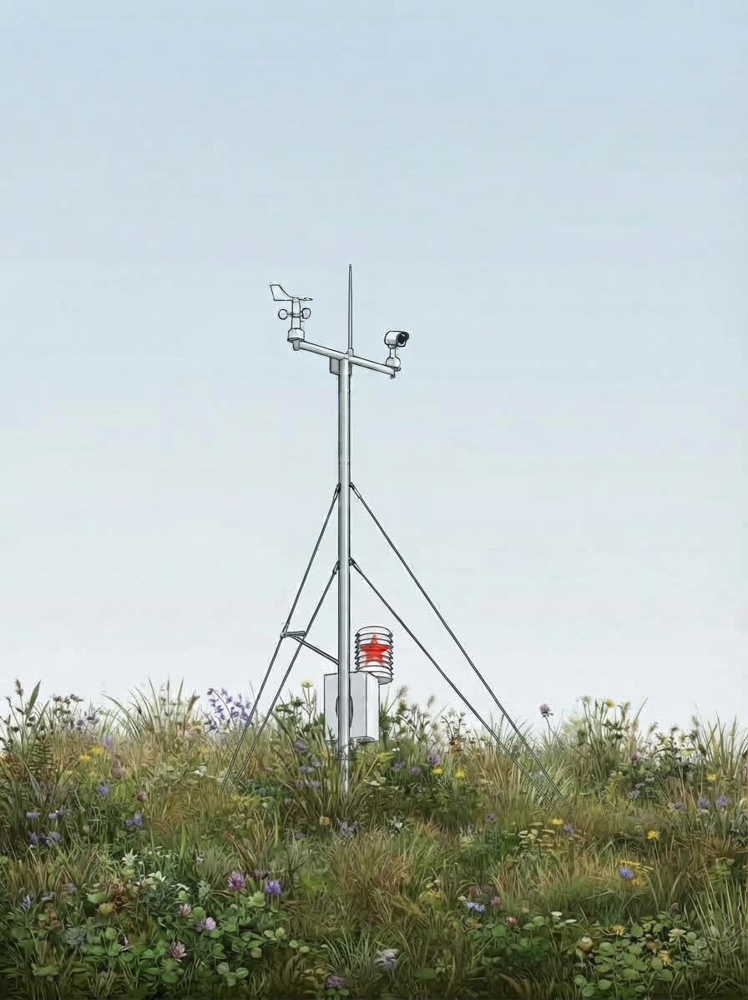
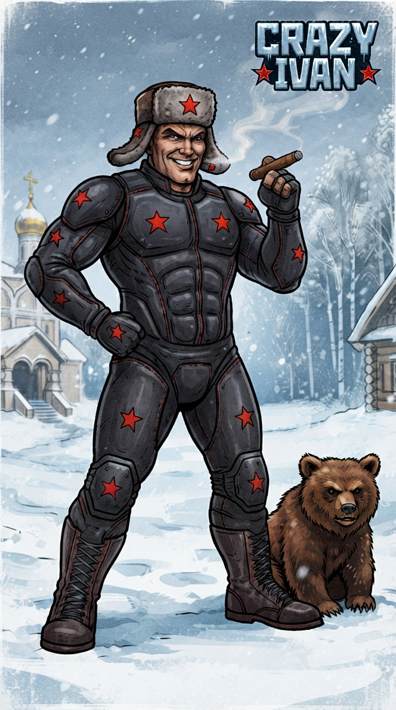

# ★ N.I.C. ★

**Native Intellect Community** — simple, proven principles, standard hardware, open designs.

**English** · [Čeština](https://github.com/Project-NIC/.github/blob/main/profile/README.cs.md) · [Русский](https://github.com/Project-NIC/.github/blob/main/profile/README.ru.md)

[What is NIC?](#what-is-nic)

---

# NIC-Arduino

**The storage, transport and viewer stack for small devices** — a crash-safe log format, optional
compression and encryption, the bridges in and out, exporters for the seismic and geomagnetic
networks, and a viewer. **Closed at v1.2 — the final version.**

→ **[Project-NIC/NIC-Arduino](https://github.com/Project-NIC/NIC-Arduino)**

<b>The modules</b> — eight

| module | what it is |
|---|---|
| [**NIC-MLA**](https://github.com/Project-NIC/NIC-Arduino/tree/main/mla) | Matroshka Logging Archive — the base log format, one crash-safe file |
| [**NIC-DMD**](https://github.com/Project-NIC/NIC-Arduino/tree/main/dmd) | Delta Markov Duda — optional compression |
| [**NIC-KSF**](https://github.com/Project-NIC/NIC-Arduino/tree/main/ksf) | Kolmogorov Shannon Feistel — optional encryption |
| [**NIC-GLUE-IN**](https://github.com/Project-NIC/NIC-Arduino/tree/main/glue-in) | write data into an MLA log |
| [**NIC-GLUE-OUT**](https://github.com/Project-NIC/NIC-Arduino/tree/main/glue-out) | read and export an MLA log — CSV, SQLite, … |
| [**NIC-MSEED**](https://github.com/Project-NIC/NIC-Arduino/tree/main/mseed) | an MLA log → miniSEED (ObsPy / SeisComP / FDSN) |
| [**NIC-IAGA**](https://github.com/Project-NIC/NIC-Arduino/tree/main/iaga) | an MLA log → IAGA-2002 (INTERMAGNET / SuperMAG) |
| [**NIC-VDE**](https://github.com/Project-NIC/NIC-Arduino/tree/main/vde) | Volkov Data Ecosystem — browse and export MLA logs |

 

---

# NIC-Heimdall

**One self-contained measuring station for the solid Earth, the atmosphere and the ionosphere** —
an enclosure with the head, the clock and the cards, and whatever units a site needs, all on one
clocked bus. Swap the units and it is a different instrument on the same bus and the same code.
**Version 0.2 — a design-stage concept:** every board described to the part, nothing built yet.
Its READMEs read in English, Czech and Russian.

→ **[Project-NIC/NIC-Heimdall](https://github.com/Project-NIC/NIC-Heimdall)**

<b>The enclosure</b> — the head, the clock, the power, the cards, the transport

| part | what it is | bus · type |
|---|---|---|
| [**Mayak**](https://github.com/Project-NIC/NIC-Heimdall/tree/main/mayak) | the head — datalogger and uplink (Wi-Fi, a modem, BLE), the archive on two microSD cards | NodBus 1 |
| [**Kronos**](https://github.com/Project-NIC/NIC-Heimdall/tree/main/kronos) | the timekeeper — a GNSS-disciplined TCXO, the network clock and the second to every card | — |
| ↳ [**Polaris**](https://github.com/Project-NIC/NIC-Heimdall/tree/main/kronos/polaris) | Kronos's GNSS front, bought — a time-only receiver and antenna on a carrier | — |
| [**Hermes**](https://github.com/Project-NIC/NIC-Heimdall/tree/main/hermes) | the BMS/MPPT converter — reads the bought pack and charger for the head | — |
| [**Bifrost**](https://github.com/Project-NIC/NIC-Heimdall/tree/main/bifrost) | the NodBus master — four point-to-point spurs, copper to 500 m, glass beyond | NodBus 2 |
| ↳ [**Argus**](https://github.com/Project-NIC/NIC-Heimdall/tree/main/bifrost/argus) | the same card as the NodBus mini master — four segments for the small units | NodBus 3 |
| [**Galvani**](https://github.com/Project-NIC/NIC-Heimdall/tree/main/galvani) | the transport layer — eleven boards; anything that leaves the enclosure crosses one | — |
| [**Mimir**](https://github.com/Project-NIC/NIC-Heimdall/tree/main/mimir) | mini-Heimdall — the head, the clock, two cards, Palatine and Hermes on one PCB | — |
| [**Proteus**](https://github.com/Project-NIC/NIC-Heimdall/tree/main/proteus) | the smallest whole station head, one PCB in a 1-DIN slot — for a vehicle or a one-unit site | — |

<b>The units</b> — what the station measures

| unit | what it measures | bus · type |
|---|---|---|
| [**Quake**](https://github.com/Project-NIC/NIC-Heimdall/tree/main/quake) | ground motion, local events and tilt | NodBus 5 |
| [**Tesla**](https://github.com/Project-NIC/NIC-Heimdall/tree/main/tesla) | lightning — VLF sferics, every impulse timed on the network clock | NodBus 7 |
| ↳ [**Pip**](https://github.com/Project-NIC/NIC-Heimdall/tree/main/tesla/pip) | longwave carriers — the D-region, and longwave time; Tesla's board | NodBus 12 |
| ↳ [**Steinmetz**](https://github.com/Project-NIC/NIC-Heimdall/tree/main/tesla/steinmetz) | faults on power lines, from a vehicle or a site; Tesla's board | NodBus 13 |
| [**Marconi**](https://github.com/Project-NIC/NIC-Heimdall/tree/main/marconi) | the HF ionosphere — transmitter levels 0,5–16 MHz, a passive ionogram | NodBus 4 |
| [**Sputnik**](https://github.com/Project-NIC/NIC-Heimdall/tree/main/sputnik) | GNSS — total electron content, and the station's time when fitted | NodBus 8 |
| [**Palatine**](https://github.com/Project-NIC/NIC-Heimdall/tree/main/palatine) | the meteo base — four ModBus arms for the bought weather set and the house modules | NodBus 6 |
| ↳ [**Chinook**](https://github.com/Project-NIC/NIC-Heimdall/tree/main/palatine/chinook) | air quality — bought units on Palatine's arms | — |
| [**Quark**](https://github.com/Project-NIC/NIC-Heimdall/tree/main/quark) | radiation — two builds, by tubes and by scintillation | — |
| ↳ [**Quark-Tubes**](https://github.com/Project-NIC/NIC-Heimdall/tree/main/quark/tubes) | every tube counted on one board — GM tubes, Helion and Gadolin for neutrons | mini 2 |
| ↳ [**Photon**](https://github.com/Project-NIC/NIC-Heimdall/tree/main/quark/scintillation/photon) | γ / X-ray by scintillation, counts and energy | NodBus 9 |
| ↳ [**Positron**](https://github.com/Project-NIC/NIC-Heimdall/tree/main/quark/scintillation/positron) | beta, both signs, with Neutron's channel on the same board | NodBus 11 |
| [**Gauss**](https://github.com/Project-NIC/NIC-Heimdall/tree/main/gauss) | the slow geomagnetic field — a sealed magnetometer sonde | mini 1 |
| [**Pascal**](https://github.com/Project-NIC/NIC-Heimdall/tree/main/pascal) | a tsunami gauge on the sea floor | mini 3 |
| [**Pluvius**](https://github.com/Project-NIC/NIC-Heimdall/tree/main/pluvius) | precipitation, weighed | ModBus 5 |
| [**Ceres**](https://github.com/Project-NIC/NIC-Heimdall/tree/main/ceres) | soil moisture and temperature, through glass | ModBus 6 |
| ↳ [**Sakura**](https://github.com/Project-NIC/NIC-Heimdall/tree/main/ceres/sakura) | leaf wetness — Ceres's board in the canopy | ModBus 7 |
| [**Babel**](https://github.com/Project-NIC/NIC-Heimdall/tree/main/babel) | any sensor → Modbus RTU, converted at the sensor | ModBus 4 |

<b>The station as a whole, and the software</b>

| part | what it is |
|---|---|
| [**Atlantis**](https://github.com/Project-NIC/NIC-Heimdall/tree/main/atlantis) | the water build — Pascal and Gauss off shore; the long deep run is shelved |
| [**Daedalus**](https://github.com/Project-NIC/NIC-Heimdall/tree/main/daedalus) | building the station — mast, earthing, enclosure, vault, cables |
| [**Gaia**](https://github.com/Project-NIC/NIC-Heimdall/tree/main/gaia) | the siting atlas — where the stations go across the planet |
| [**HMC**](https://github.com/Project-NIC/NIC-Heimdall/blob/main/core/archive/HMC.md) | Heimdall Matryoshka Container — the station's archive, from the card to the server |
| [**HCC**](https://github.com/Project-NIC/NIC-Heimdall/blob/main/core/archive/HCC.md) | Heimdall Compression Codec — lossless, column by column; a Python reference with its tests |
| [**Exporters**](https://github.com/Project-NIC/NIC-Heimdall/blob/main/core/archive/EXPORTERS.md) | the archive in the world's formats — miniSEED, IAGA-2002, RINEX, BUFR, CSV, SQL, … |
| [**Server**](https://github.com/Project-NIC/NIC-Heimdall/blob/main/core/archive/HMC.md#on-the-server) | the files as the archive of record, a catalogue over them, and the viewer |
| [**Handset**](https://github.com/Project-NIC/NIC-Heimdall/tree/main/mayak/handset) | the commissioning app — the phone at the open enclosure, over BLE |

 

---

# NIC-BumbleBee <i>Russian Power</i>

**The power side — NIC-FPLG, a crankshaft-free two-stroke linear engine:** two pistons on one rod
with a tubular linear generator at its centre, running at mechanical resonance rather than at a
controlled speed. ~3 kW mechanical, 1–1,5 kW electrical; **twinned in anti-phase** it cancels ~88 %
of its own vibration.

→ **[Project-NIC/NIC-BumbleBee](https://github.com/Project-NIC/NIC-BumbleBee)**

 

---

# NIC-Strelka

**The motion of an animal, for a veterinary examination** — small units on the legs, the trunk and
the head of a dog, a horse or a cow record how it moves, all on one common time, so that the legs,
the trunk and the head can be laid side by side, step by step. Live on a phone or a computer, the
whole record afterwards. To replace the cheap sensor sets sold today: at their price or below, and
better in any case. Only the motion, not where the animal goes; everything on the animal, no
camera, no walkway.

**The live view** at 50 or 100 Hz, as quaternions the Belka computes from its accelerometer's
and gyroscope's values, or the raw steps; **the card** takes the raw data at the full sampling rate. **Vibration, as
an experiment:** since the hardware allows it, we want to try higher sampling too, up to the
sensor's maximum, for experimental measurements of vibration on machines and the like.

→ **[Project-NIC/NIC-Strelka](https://github.com/Project-NIC/NIC-Strelka)** — beta 0.75: the whole design on paper, the firmware built, the application begun, nothing run yet; 0.8 comes with the boards

<b>The parts</b> — the unit, the commander, the box, the dock, the application

| part | what it is |
|---|---|
| **Belka** | the unit on the animal, with its sensor and its card, 1 to 32 in a set |
| **Povodok** | the set's commander: the Belka's board without the sensor and the card, with Fanstel's WM02C20C combo in place of the BM20F — the nRF54LM20A with Nordic's nRF7002 Wi-Fi 6, used at 5 GHz alone; it gives the set its common time, and the first of them gathers the whole set and passes it to the phone or the computer, by USB or Wi-Fi |
| **Budka** | the box a Belka lives in: a sealed Hammond 1551 case, its window for the light, its fastening |
| **the dock** | a charging station for the whole set with a USB hub: every Belka in it a disk, a computer copying them all at once |
| **Pušinka** | the application on the phone or the computer, begun in Flutter: one code for Android, iPhone, Windows, macOS and Linux, its base in the repository; in time perhaps whole applications |

<b>Inside a Belka</b> — the modules and the parts

- Fanstel's BM20F module: Nordic's nRF54LM20A processor and radio, the set's own radio at 2,4 GHz, an antenna on the board
- the motion sensor, on one land: ST's LSM6DSV16X, ±16 g and ±4 000 °/s, in the classic build; ST's LSM6DSV320X, ±16 g and a second channel to ±320 g, for the hoof; TDK's ICM-42686-P, ±32 g and ±4 000 °/s, for the industrial build's raw data up to 32 kHz
- the user's own microSD card in a locking slot, for the whole record
- a LiFePO4 cell, LTOPOW's LFP103042, 3,2 V, 720 mAh
- TI's BQ25170 charger and ADI's MAX17055 fuel gauge
- two TI TPS7A2030 regulators at 3,0 V
- a five-pin magnetic contact for the charge and USB, wired symmetric so that it goes on either way round, its inlet guarded
- two TI DRV5032 Hall switches: the unit is worked by a magnet held to it instead of buttons, so that the box stays watertight
- a two-colour LED

 

---

# NIC-CrazyIvan

**A neural suit** — up to 582 electrodes and 98 motion sensors, 56 of them in the gloves and the
socks, on a suit put together from pieces: a sleeve, a trouser leg, the torso, a headband. The muscles' own signals and the body's
motion go to a computer in the backpack, a Radxa ROCK 5T with its own NPU or up to two Hailo-10H AI
accelerators, and the whole body becomes the controller for a computer or a game. Second, an
aid for rehabilitation: a doctor sees which muscle works and how hard.
**Coming soon™.** Well — not *that* soon.

→ **[Project-NIC/NIC-Crazy_Ivan](https://github.com/Project-NIC/NIC-Crazy_Ivan)** — beta 0.6: the ADS1298 on every module and the LSM6DSV16X held to the suit's clock, polyimide strips shielded on both faces, the units potted on the harness with connectors for assembly only, Mamka's converters at 1 MHz, Mrazík the cooling block; still on paper, nothing built yet

<b>The parts and every name</b> — the suit, the head, the family in the backpack, the assistants

| part | what it is |
|---|---|
| [**Rubaška**](https://github.com/Project-NIC/NIC-Crazy_Ivan/tree/main/rubaska) | the shirt: the suit itself, the pieces with their sensing modules, the Rebjata, the glove Vešč and the sock Nosok, the electrodes |
| ↳ [**Kaščej**](https://github.com/Project-NIC/NIC-Crazy_Ivan/blob/main/rubaska/CONSTRUCTION.md#harness-and-washing) | Koschei the Deathless: the harness, a skin-tight overall with the bands and the modules on it, rinsed in clean water |
| ↳ [**Strejda Al**](https://github.com/Project-NIC/NIC-Crazy_Ivan/blob/main/rubaska/CONSTRUCTION.md#harness-and-washing) | Uncle Al, after Big Gay Al of *South Park*: the tight compression overall over Kaščej that presses the electrodes to the body |
| ↳ [**Rebjata**](https://github.com/Project-NIC/NIC-Crazy_Ivan/blob/main/rubaska/HARDWARE.md#sensing-module) | the kids: the sensing modules, Mamka's own children, each one a Rebjonok; two ADS1298, 16 EMG channels and the motion sensors |
| ↳ [**Staršaja**](https://github.com/Project-NIC/NIC-Crazy_Ivan/blob/main/rubaska/HARDWARE.md#sensing-module) | the elder: every sensing unit's main processor, an STM32H523 |
| ↳ [**Bratiški**](https://github.com/Project-NIC/NIC-Crazy_Ivan/blob/main/rubaska/HARDWARE.md#the-glove) | the little brothers: the small processors on the glove's and the sock's board, one a finger |
| ↳ [**Vešč**](https://github.com/Project-NIC/NIC-Crazy_Ivan/blob/main/rubaska/HARDWARE.md#the-glove) | the Thing, the Addams' hand: the glove, one board on the back of the hand, 16 electrodes and up to 20 motion sensors |
| ↳ [**Nosok**](https://github.com/Project-NIC/NIC-Crazy_Ivan/blob/main/rubaska/HARDWARE.md#the-sock) | the sock: the glove's board for the foot, worn above the ankle |
| [**Bogatyr**](https://github.com/Project-NIC/NIC-Crazy_Ivan/tree/main/bogatyr) | the strongman: where every electrode and motion sensor sits on the body, muscle by muscle, and why |
| [**Nataša**](https://github.com/Project-NIC/NIC-Crazy_Ivan/tree/main/natasa) | the unit in the headband: headphones, two microphones, vibration and buttons |
| [**Mamka**](https://github.com/Project-NIC/NIC-Crazy_Ivan/tree/main/mamka) | mum, the base board: the clock for the whole suit, the sound bridge, the line drivers and the suit's power |
| ↳ [**Chodiki**](https://github.com/Project-NIC/NIC-Crazy_Ivan/blob/main/mamka/HARDWARE.md#clock) | the wall clock with weights: the one clock the whole suit samples by |
| ↳ [**Pupovina**](https://github.com/Project-NIC/NIC-Crazy_Ivan/blob/main/porjadok/HARDWARE.md#links-between-boards) | the umbilical cord: the eight lines from Mamka, one a piece of the suit, with power, the clock and data |
| ↳ [**Kormilica**](https://github.com/Project-NIC/NIC-Crazy_Ivan/blob/main/mamka/HARDWARE.md#mamkas-own-supply) | the wet nurse: Mamka's power section, her converters and the computers' supply |
| ↳ [**Budilnik**](https://github.com/Project-NIC/NIC-Crazy_Ivan/blob/main/mamka/HARDWARE.md#budilnik) | the alarm clock: the start button that wakes the whole household |
| [**Baťa**](https://github.com/Project-NIC/NIC-Crazy_Ivan/tree/main/bata) | dad, the computer in the backpack: a Radxa ROCK 5T, with Umnica, the Hailo-10H, or its own NPU alone |
| ↳ [**Umnica**](https://github.com/Project-NIC/NIC-Crazy_Ivan/blob/main/bata/HARDWARE.md#umnica) | the clever one: a Hailo-10H, the educated daughter who thinks for dad |
| ↳ [**Borovičok**](https://github.com/Project-NIC/NIC-Crazy_Ivan/blob/main/bata/HARDWARE.md#borovičok) | Staričok-Borovičok, the little old mushroom man, Babuška's husband: computer B, the applications and the glasses |
| ↳ [**Ďaďa Sem**](https://github.com/Project-NIC/NIC-Crazy_Ivan/blob/main/bata/HARDWARE.md#ďaďa-sem) | Uncle Sam, who lives in the attic and watches everything: the cameras |
| ↳ [**Storož**](https://github.com/Project-NIC/NIC-Crazy_Ivan/blob/main/bata/SOFTWARE.md#storož) | the night watchman, our Tron: when something fatal breaks he stops the household and says why |
| ↳ **Nastěnka** | the good stepdaughter of *Mrazík*: the main software |
| ↳ **Macecha** | her stepmother: the strict correcting software that lets nothing through |
| ↳ [**Perevodčica**](https://github.com/Project-NIC/NIC-Crazy_Ivan/blob/main/porjadok/SOFTWARE.md#output) | the interpreter: the output's converters for Unreal, Unity, VRChat, a lab or a robot |
| [**Terem**](https://github.com/Project-NIC/NIC-Crazy_Ivan/tree/main/terem) | the daughters' chamber: the board in the ROCK 5T's two M.2 slots, its two Hailo-10H with a supply each |
| [**Porjadok**](https://github.com/Project-NIC/NIC-Crazy_Ivan/tree/main/porjadok) | order: what holds for every module, the processor, the firmware and the links |
| ↳ [**Pitanije**](https://github.com/Project-NIC/NIC-Crazy_Ivan/blob/main/porjadok/HARDWARE.md#power) | food, and a power supply: the suit's power from Babuška down to every module |
| [**Babuška**](https://github.com/Project-NIC/NIC-Crazy_Ivan/tree/main/babuska) | grandma: the battery and its BMS, the hard-shell backpack |
| ↳ [**Ključnica**](https://github.com/Project-NIC/NIC-Crazy_Ivan/blob/main/babuska/HARDWARE.md#the-bms) | the housekeeper with the keys: the BMS, which decides what goes in and out of Babuška's pantry |
| ↳ **Kommunalka** | a communal flat: the backpack, where the whole family lives and shares one kitchen |
| ↳ [**Mrazík**](https://github.com/Project-NIC/NIC-Crazy_Ivan/blob/main/babuska/CONSTRUCTION.md#mrazík) | Father Frost: the closed aluminium cooling block around the computer and Mamka |
| [**Soňa**](https://github.com/Project-NIC/NIC-Crazy_Ivan/tree/main/sona) | assistant for the deaf: listens all the time and tells by vibration what is happening around |
| [**Míša**](https://github.com/Project-NIC/NIC-Crazy_Ivan/tree/main/misa) | assistant, the watchdog: a radar and ultrasound watch for obstacles and warn through the headphones and the headband |
| [**Taťána**](https://github.com/Project-NIC/NIC-Crazy_Ivan/tree/main/tatana) | assistant: types what you dictate and reads text aloud, books included |
| [**Nikita**](https://github.com/Project-NIC/NIC-Crazy_Ivan/tree/main/nikita) | assistant: the beat of the music as vibration |
| [**Pomoščnik**](https://github.com/Project-NIC/NIC-Crazy_Ivan/tree/main/pomoscnik) | assistant, the helper: looks at a part, reads its marking and finds it, with the glasses and the cameras |

 

---

# NIC-Sluchalo

**What is in a wall, seen by the shadow Wi-Fi casts through it** — a hand-held head with eleven
Wi-Fi receivers slides along one face of a wall while a small box behind the other face sends; a
cable, a pipe or a steel stud between them dims the field, and the head maps where. For brick
walls it also taps the wall and listens. The head is 167 mm across: a ring of nine antennas
30 × 29 mm on a circle of 65,8 mm radius around a crossed pair, 15 mm of foam with a hard sliding
sheet against the wall, about 0,36 kg before the housing, about three hours on two 18650 cells.
Every setting and all the raw data stay open.

→ **[Project-NIC/NIC-Sluchalo](https://github.com/Project-NIC/NIC-Sluchalo)** — 0.1, a concept: the physics computed, the head and its electronics on paper; nothing built or measured yet

<b>The parts</b> — the lantern, the ring, the woodpecker and the rest

| part | what it is |
|---|---|
| **Fonar** | the lantern: the sender behind the wall, two ESP32-C5 boards with crossed antennas taking turns |
| **Kolchoz** | the collective farm: the ring of nine receivers that work as one, and the crossed pair in the middle — eleven ESP32-C5 on one clock |
| **Datel** | the woodpecker: a knock through a plastic rod in the middle, eight microphones around it |
| **Razvedčik** | the scout: two optical-flow sensors that track the head over the wall |
| **Gensek** | the general secretary: one STM32H7A3 over everything |
| **Pajok** | the ration: two 18650 cells |
| **Gradusnik** | the thermometer: a thermal sensor, postponed |

 

---

# ★ N.I.C. ★
## NIC — Native Intellect Community
### Viva la résistance! ✊

---

## What is NIC?

NIC is for people who:

- Use simple and proven principles
- Are willing to test and create
- Work with standardized hardware and environments
- Don't need bloated solutions to prove they know what they're doing

NIC is a revolutionary movement of all comrades who are fed up with today's overpriced and unnecessarily complex world.

*"Strength lies in simplicity."*

★ **Viva la résistance!** ★

---

