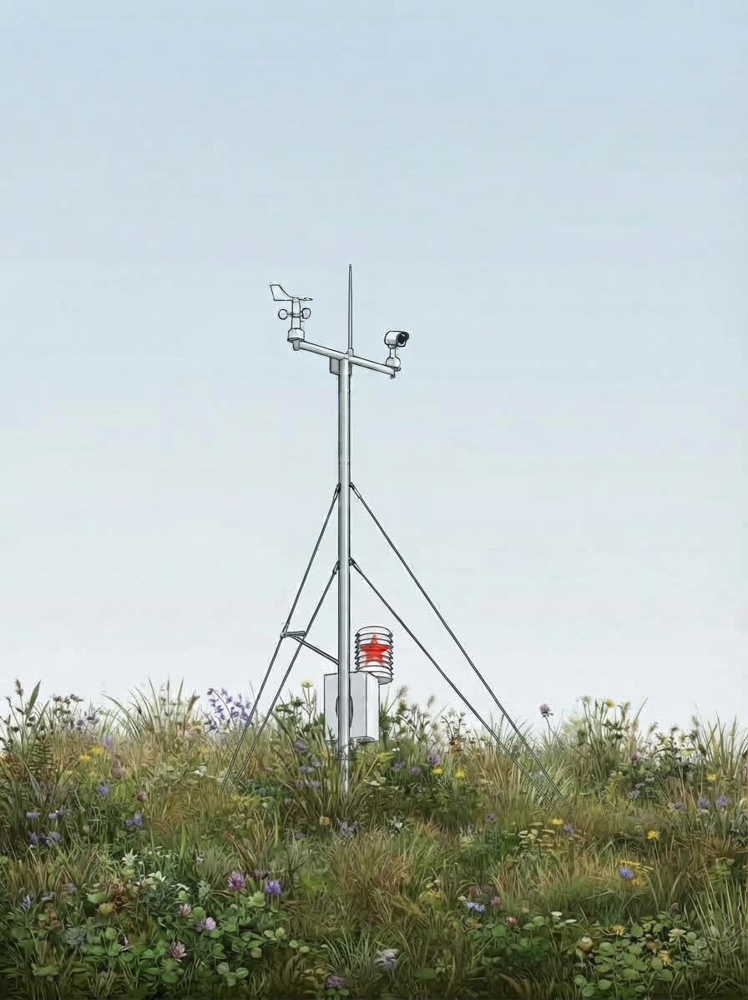
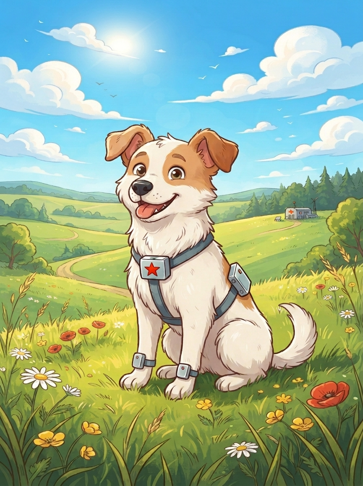
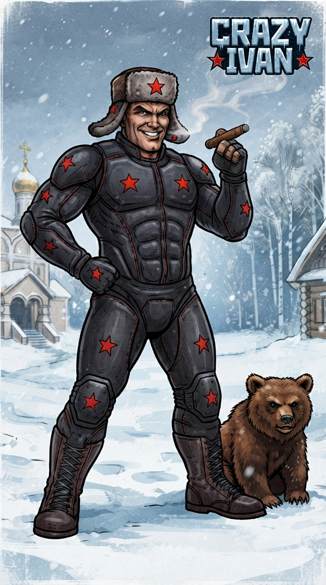

# ★ N.I.C. ★

**Native Intellect Community** — простые проверенные принципы, стандартное железо, открытые проекты.

[English](https://github.com/Project-NIC) · [Čeština](https://github.com/Project-NIC/.github/blob/main/profile/README.cs.md) · **Русский**

[Что такое NIC?](#что-такое-nic)

---

# NIC-Arduino

**Программный стек хранения, передачи и просмотра данных для малых устройств** — формат журнала,
устойчивый к сбоям, необязательные сжатие и шифрование, мосты на вход и выход, экспортёры для
сейсмических и геомагнитных сетей и просмотрщик. **Закрыт на версии 1.2 — окончательная версия.**

→ **[Project-NIC/NIC-Arduino](https://github.com/Project-NIC/NIC-Arduino)**

<b>Модули</b> — восемь

| модуль | что это |
|---|---|
| [**NIC-MLA**](https://github.com/Project-NIC/NIC-Arduino/tree/main/mla) | Matroshka Logging Archive — базовый формат журнала, один устойчивый к сбоям файл |
| [**NIC-DMD**](https://github.com/Project-NIC/NIC-Arduino/tree/main/dmd) | Delta Markov Duda — необязательное сжатие |
| [**NIC-KSF**](https://github.com/Project-NIC/NIC-Arduino/tree/main/ksf) | Kolmogorov Shannon Feistel — необязательное шифрование |
| [**NIC-GLUE-IN**](https://github.com/Project-NIC/NIC-Arduino/tree/main/glue-in) | запись данных в журнал MLA |
| [**NIC-GLUE-OUT**](https://github.com/Project-NIC/NIC-Arduino/tree/main/glue-out) | чтение и экспорт журнала MLA — CSV, SQLite, … |
| [**NIC-MSEED**](https://github.com/Project-NIC/NIC-Arduino/tree/main/mseed) | журнал MLA → miniSEED (ObsPy / SeisComP / FDSN) |
| [**NIC-IAGA**](https://github.com/Project-NIC/NIC-Arduino/tree/main/iaga) | журнал MLA → IAGA-2002 (INTERMAGNET / SuperMAG) |
| [**NIC-VDE**](https://github.com/Project-NIC/NIC-Arduino/tree/main/vde) | Volkov Data Ecosystem — просмотр и экспорт журналов MLA |

 

---

# NIC-Heimdall

**Одна автономная измерительная станция для твёрдой Земли, атмосферы и ионосферы** — корпус
с центральным блоком, часами и картами и те блоки, которые нужны на данном месте, всё на одной
тактированной шине. Замените блоки — и это другой прибор на той же шине и с тем же кодом.
**Версия 0.3 — концепция на стадии проектирования:** каждая плата описана до последнего
компонента, код над выводами написан и проверен на компьютере, пока ничего не построено. README — на английском, чешском и русском.

→ **[Project-NIC/NIC-Heimdall](https://github.com/Project-NIC/NIC-Heimdall)**

<b>Корпус</b> — центральный блок, часы, питание, карты, передача

| часть | что это | шина · тип |
|---|---|---|
| [**Mayak**](https://github.com/Project-NIC/NIC-Heimdall/tree/main/mayak) | центральный блок — регистратор и связь с миром (Wi-Fi, модем, BLE), архив на двух картах microSD | NodBus 1 |
| [**Kronos**](https://github.com/Project-NIC/NIC-Heimdall/tree/main/kronos) | часы — TCXO, подстраиваемый по GNSS, такт сети и секунда для каждой карты | — |
| ↳ [**Polaris**](https://github.com/Project-NIC/NIC-Heimdall/tree/main/kronos/polaris) | GNSS-фронтенд Kronos, покупной — приёмник только для времени и антенна на плате-носителе | — |
| [**Hermes**](https://github.com/Project-NIC/NIC-Heimdall/tree/main/hermes) | преобразователь BMS/MPPT — читает для центрального блока покупную батарею и зарядное устройство | — |
| [**Bifrost**](https://github.com/Project-NIC/NIC-Heimdall/tree/main/bifrost) | мастер шины NodBus — четыре отвода точка–точка, медь до 500 m, дальше стекло | NodBus 2 |
| ↳ [**Argus**](https://github.com/Project-NIC/NIC-Heimdall/tree/main/bifrost/argus) | та же карта как мастер NodBus mini — четыре сегмента для малых блоков | NodBus 3 |
| [**Galvani**](https://github.com/Project-NIC/NIC-Heimdall/tree/main/galvani) | транспортный уровень — одиннадцать плат; всё, что выходит из корпуса, проходит через одну из них | — |
| [**Mimir**](https://github.com/Project-NIC/NIC-Heimdall/tree/main/mimir) | mini-Heimdall — центральный блок, часы, две карты, Palatine и Hermes на одной плате | — |
| [**Proteus**](https://github.com/Project-NIC/NIC-Heimdall/tree/main/proteus) | самый маленький полный центральный блок станции, одна плата в слот 1-DIN — для машины или места с одним блоком | — |

<b>Блоки</b> — что измеряет станция

| блок | что измеряет | шина · тип |
|---|---|---|
| [**Quake**](https://github.com/Project-NIC/NIC-Heimdall/tree/main/quake) | движение грунта, местные события и наклон | NodBus 5 |
| [**Tesla**](https://github.com/Project-NIC/NIC-Heimdall/tree/main/tesla) | молнии — сферики ОНЧ, каждый импульс привязан к часам сети | NodBus 7 |
| ↳ [**Pip**](https://github.com/Project-NIC/NIC-Heimdall/tree/main/tesla/pip) | длинноволновые несущие — область D и время по длинным волнам; плата Tesla | NodBus 12 |
| ↳ [**Steinmetz**](https://github.com/Project-NIC/NIC-Heimdall/tree/main/tesla/steinmetz) | повреждения на линиях электропередачи, с машины или с места; плата Tesla | NodBus 13 |
| [**Marconi**](https://github.com/Project-NIC/NIC-Heimdall/tree/main/marconi) | ионосфера в КВ-диапазоне — уровни передатчиков 0,5–16 MHz, пассивная ионограмма | NodBus 4 |
| [**Sputnik**](https://github.com/Project-NIC/NIC-Heimdall/tree/main/sputnik) | GNSS — полное электронное содержание и время станции, если установлен | NodBus 8 |
| [**Palatine**](https://github.com/Project-NIC/NIC-Heimdall/tree/main/palatine) | метеобаза — четыре ветви ModBus для покупного метеокомплекта и собственных модулей | NodBus 6 |
| ↳ [**Chinook**](https://github.com/Project-NIC/NIC-Heimdall/tree/main/palatine/chinook) | качество воздуха — покупные блоки на ветвях Palatine | — |
| [**Quark**](https://github.com/Project-NIC/NIC-Heimdall/tree/main/quark) | радиация — два исполнения, трубками и сцинтилляцией | — |
| ↳ [**Quark-Tubes**](https://github.com/Project-NIC/NIC-Heimdall/tree/main/quark/tubes) | каждая трубка считается на одной плате — трубки ГМ, Helion и Gadolin для нейтронов | mini 2 |
| ↳ [**Photon**](https://github.com/Project-NIC/NIC-Heimdall/tree/main/quark/scintillation/photon) | гамма и рентген сцинтилляцией, счёт и энергия | NodBus 9 |
| ↳ [**Positron**](https://github.com/Project-NIC/NIC-Heimdall/tree/main/quark/scintillation/positron) | бета обоих знаков, на той же плате с каналом Neutron | NodBus 11 |
| [**Gauss**](https://github.com/Project-NIC/NIC-Heimdall/tree/main/gauss) | медленное геомагнитное поле — герметичный магнитометрический зонд | mini 1 |
| [**Pascal**](https://github.com/Project-NIC/NIC-Heimdall/tree/main/pascal) | датчик цунами на морском дне | mini 3 |
| [**Pluvius**](https://github.com/Project-NIC/NIC-Heimdall/tree/main/pluvius) | осадки, взвешиванием | ModBus 5 |
| [**Ceres**](https://github.com/Project-NIC/NIC-Heimdall/tree/main/ceres) | влажность и температура почвы, через стекло | ModBus 6 |
| ↳ [**Sakura**](https://github.com/Project-NIC/NIC-Heimdall/tree/main/ceres/sakura) | увлажнённость листьев — плата Ceres в кроне | ModBus 7 |
| [**Babel**](https://github.com/Project-NIC/NIC-Heimdall/tree/main/babel) | любой датчик → Modbus RTU, преобразование у датчика | ModBus 4 |

<b>Станция в целом и программы</b>

| часть | что это |
|---|---|
| [**Atlantis**](https://github.com/Project-NIC/NIC-Heimdall/tree/main/atlantis) | морское исполнение — Pascal и Gauss у берега; длинная глубоководная линия отложена |
| [**Daedalus**](https://github.com/Project-NIC/NIC-Heimdall/tree/main/daedalus) | постройка станции — мачта, заземление, корпус, колодец, кабели |
| [**Gaia**](https://github.com/Project-NIC/NIC-Heimdall/tree/main/gaia) | атлас размещения — где на планете стоят станции |
| [**HMC**](https://github.com/Project-NIC/NIC-Heimdall/blob/main/core/archive/HMC.md) | Heimdall Matryoshka Container — архив станции, от карты до сервера |
| [**HCC**](https://github.com/Project-NIC/NIC-Heimdall/blob/main/core/archive/HCC.md) | Heimdall Compression Codec — без потерь, столбец за столбцом; эталонная реализация на Python с тестами |
| [**Exporters**](https://github.com/Project-NIC/NIC-Heimdall/blob/main/core/archive/EXPORTERS.md) | архив в форматах, которые принимает мир — miniSEED, IAGA-2002, RINEX, BUFR, CSV, SQL, … |
| [**Server**](https://github.com/Project-NIC/NIC-Heimdall/blob/main/core/archive/HMC.md#on-the-server) | файлы как основной архив, каталог над ними и просмотрщик |
| [**Handset**](https://github.com/Project-NIC/NIC-Heimdall/tree/main/mayak/handset) | приложение для ввода в эксплуатацию — телефон у открытого корпуса, через BLE |

 

---

# NIC-BumbleBee <i>Russian Power</i>

**Энергетическая часть — NIC-FPLG, двухтактный линейный двигатель без коленчатого вала:** два
поршня на одном штоке с трубчатым линейным генератором в центре, работающий в механическом
резонансе, а не на регулируемых оборотах. ~3 kW механической мощности, 1–1,5 kW электрической;
**спаренный в противофазе**, он гасит ~88 % собственной вибрации.

→ **[Project-NIC/NIC-BumbleBee](https://github.com/Project-NIC/NIC-BumbleBee)**

 

---

# NIC-Strelka

**Движение животного для ветеринарного осмотра** — маленькие блоки на ногах, туловище и голове
собаки, лошади или коровы записывают, как животное движется, все по одному общему времени: вживую
на телефоне или компьютере, вся запись потом. Замена дешёвым наборам датчиков, которые продают
сегодня, по их цене или ниже и в любом случае лучше; а в порядке опыта — и вибрация на машинах.

→ **[Project-NIC/NIC-Strelka](https://github.com/Project-NIC/NIC-Strelka)** — бета 0.85: весь проект на бумаге, платы описаны для рисования, прошивка собрана, основа приложения с шестью меню, ничего ещё не запускалось; 0.9 придёт с нарисованными платами

<b>Части</b> — блоки, командир, корпуса и кейс, стыковка, приложение

| часть | что это |
|---|---|
|  **Belka** | блок на животном, с датчиком и картой, в наборе от 1 до 32, на Materinka, базовой плате, ядро которой общее для всех блоков. Ugoljok, для сильных ударов на копыте, описан, но не делается: кому он нужен, тот его соберёт |
|  **Zvjozdočka** | Belka для промышленности, с сырыми данными до 32 кГц: для машин в цехе, отдельный набор со своим Povodok |
|  **Kryska** | маленькая Belka, для мелких животных и обычных осмотров: модуль Fanstel BM20M, память на плате, прочная в базовом исполнении |
|  **Povodok** | командир набора, от одного до четырёх в наборе: своя Materinka с модулем Fanstel WM02C20C, Wi-Fi на 5 ГГц, без датчика и карты; даёт набору время и передаёт то, что он измеряет, на телефон или компьютер по USB или Wi-Fi |
|  **Korabl** | корпус блока, у каждого своего размера: герметичный корпус, окошко для светодиода, крепление |
|  **Semjorka** | кейс, в котором носят весь набор |
|  **Stykovka** | часть оборудования: пятиконтактный магнитный разъём, на кабеле или на станции для всего набора с USB-хабом; служит только для зарядки и USB к компьютеру, который копирует все блоки разом |
|  **Pušinka** | приложение на телефоне или компьютере, его основа на Flutter с шестью меню: один код для Android, iPhone, Windows, macOS и Linux |

<b>Что внутри Belka</b> — модули и детали

- модуль Fanstel BM20F: процессор и радио Nordic nRF54LM20A, собственное радио набора на 2,4 ГГц, антенна на печатной плате
- датчик движения на одних площадках: ST LSM6DSV16X, ±16 g и ±4 000 °/с, в Belka; ST LSM6DSV320X, ±16 g и второй канал до ±320 g, в Ugoljok для копыта; TDK ICM-42686-P, ±32 g и ±4 000 °/с, в Zvjozdočka для сырых данных до 32 кГц
- собственная карта microSD пользователя в слоте с защёлкой, для всей записи
- элемент LiFePO4 LTOPOW LFP103042, 3,2 В, 720 мА·ч
- PMIC Nordic nPM1300: зарядка, выключение отключением элемента (ship mode), измерение элемента для счётчика заряда Nordic, драйверы светодиода
- два стабилизатора TI TPS7A2030 на 3,0 В
- пятиконтактный магнитный разъём для зарядки и USB, подключённый симметрично, так что встаёт любой стороной, с защитой входа
- два датчика Холла TI DRV5032: блок управляется приложенным магнитом вместо кнопок, чтобы корпус оставался водонепроницаемым
- двухцветный светодиод, который зажигает и сам PMIC

 

---

# NIC-CrazyIvan

**Нейрокостюм** — до 580 электродов и 108 датчиков движения, 64 из них в перчатках и носках, на
костюме из частей: рукав, штанина, торс, повязка. Собственные сигналы мышц и движение тела идут в компьютер в
рюкзаке, Radxa ROCK 5T со своим NPU или с одним или двумя ИИ-ускорителями Hailo-10H, и
всё тело становится контроллером для компьютера или игры. А ещё помощь в реабилитации: врач
видит, какая мышца работает и насколько сильно. **Coming soon™.** Ну, не *так* уж скоро.

→ **[Project-NIC/NIC-Crazy_Ivan](https://github.com/Project-NIC/NIC-Crazy_Ivan)** — бета 0.6: ADS1298 на каждом модуле и LSM6DSV16X на такте костюма, полиимидные ленты, экранированные с обеих сторон, блоки залиты гелем на сбруе и разъёмы только для сборки, преобразователи Мамки на 1 МГц, Mrazík — блок охлаждения; всё ещё на бумаге, ничего ещё не построено;
README по-русски, остальные страницы по-английски

<b>Части и все имена</b> — костюм, голова, семья в рюкзаке, помощники

| часть | что это |
|---|---|
| [**Rubaška**](https://github.com/Project-NIC/NIC-Crazy_Ivan/tree/main/rubaska) | рубашка: сам костюм, части с измерительными модулями, Ребята, перчатка Vešč и носок Nosok, электроды |
| ↳ [**Kaščej**](https://github.com/Project-NIC/NIC-Crazy_Ivan/blob/main/rubaska/CONSTRUCTION.md#harness-and-washing) | Кощей Бессмертный: сбруя, облегающий комбинезон с лентами и модулями, его полощут в чистой воде |
| ↳ [**Strejda Al**](https://github.com/Project-NIC/NIC-Crazy_Ivan/blob/main/rubaska/CONSTRUCTION.md#harness-and-washing) | дядя Эл, в честь Big Gay Al из «Южного парка»: тесный компрессионный комбинезон поверх Кощея, прижимает электроды к телу |
| ↳ [**Rebjata**](https://github.com/Project-NIC/NIC-Crazy_Ivan/blob/main/rubaska/HARDWARE.md#sensing-module) | ребята: измерительные модули, собственные дети Мамки, каждый из них Rebjonok; два ADS1298, 16 каналов ЭМГ и датчики движения |
| ↳ [**Staršaja**](https://github.com/Project-NIC/NIC-Crazy_Ivan/blob/main/rubaska/HARDWARE.md#sensing-module) | старшая: главный процессор каждого измерительного блока, STM32H523 |
| ↳ [**Bratiški**](https://github.com/Project-NIC/NIC-Crazy_Ivan/blob/main/rubaska/HARDWARE.md#the-glove) | братишки: помощники Старшей на плате перчатки и носка, сейчас переключатели, по очереди подающие ей зоны датчиков движения |
| ↳ [**Vešč**](https://github.com/Project-NIC/NIC-Crazy_Ivan/blob/main/rubaska/HARDWARE.md#the-glove) | Вещь, рука семейки Аддамс: перчатка, одна плата на тыльной стороне кисти, 16 электродов и до 24 датчиков движения |
| ↳ [**Nosok**](https://github.com/Project-NIC/NIC-Crazy_Ivan/blob/main/rubaska/HARDWARE.md#the-sock) | носок: плата перчатки для стопы, над лодыжкой |
| [**Bogatyr**](https://github.com/Project-NIC/NIC-Crazy_Ivan/tree/main/bogatyr) | богатырь: правила, количества и датчики движения на теле; места электродов ждут совета специалистов |
| [**Nataša**](https://github.com/Project-NIC/NIC-Crazy_Ivan/tree/main/natasa) | блок в повязке: наушники, два микрофона, вибрация и кнопки |
| [**Mamka**](https://github.com/Project-NIC/NIC-Crazy_Ivan/tree/main/mamka) | мама, базовая плата: такт всего костюма, звуковой мост, драйверы линий и питание костюма |
| ↳ [**Chodiki**](https://github.com/Project-NIC/NIC-Crazy_Ivan/blob/main/mamka/HARDWARE.md#clock) | ходики, часы с гирями: единый такт, по которому снимает весь костюм |
| ↳ [**Pupovina**](https://github.com/Project-NIC/NIC-Crazy_Ivan/blob/main/porjadok/HARDWARE.md#links-between-boards) | пуповина: восемь линий от Мамки, по одной на часть костюма, с питанием, тактом и данными |
| ↳ [**Kormilica**](https://github.com/Project-NIC/NIC-Crazy_Ivan/blob/main/mamka/HARDWARE.md#mamkas-own-supply) | кормилица: питание костюма на Мамке, преобразователи линий, которые кормят её детей |
| [**Baťa**](https://github.com/Project-NIC/NIC-Crazy_Ivan/tree/main/bata) | батя, компьютер в рюкзаке: Radxa ROCK 5T, с Умницей, Hailo-10H, или только со своим NPU |
| ↳ [**Umnica**](https://github.com/Project-NIC/NIC-Crazy_Ivan/blob/main/bata/HARDWARE.md#umnica) | умница: Hailo-10H, учёная дочь, которая думает за батю |
| ↳ [**Borovičok**](https://github.com/Project-NIC/NIC-Crazy_Ivan/blob/main/bata/HARDWARE.md#borovičok) | Старичок-Боровичок, муж Бабушки: компьютер Б, приложения и очки |
| ↳ [**Ďaďa Sem**](https://github.com/Project-NIC/NIC-Crazy_Ivan/blob/main/bata/HARDWARE.md#ďaďa-sem) | дядя Сэм, живёт на чердаке и всё видит: камеры |
| ↳ [**Storož**](https://github.com/Project-NIC/NIC-Crazy_Ivan/blob/main/bata/SOFTWARE.md#storož) | сторож, наш Трон: когда ломается что-то роковое, останавливает семейство и говорит почему |
| ↳ [**Budilnik**](https://github.com/Project-NIC/NIC-Crazy_Ivan/blob/main/bata/SOFTWARE.md#budilnik) | будильник: фразой в наушниках будит того, кто оставил костюм в покое, а если никто не отзовётся, укладывает дом спать |
| ↳ **Nastěnka** | добрая падчерица из «Морозко»: главная программа |
| ↳ **Macecha** | её мачеха: строгая корректирующая программа, которая ничего не пропустит |
| ↳ [**Perevodčica**](https://github.com/Project-NIC/NIC-Crazy_Ivan/blob/main/porjadok/SOFTWARE.md#output) | переводчица: преобразователи выхода для Unreal, Unity, VRChat, лаборатории или робота |
| [**Terem**](https://github.com/Project-NIC/NIC-Crazy_Ivan/tree/main/terem) | терем: плата в двух слотах M.2 у ROCK 5T, два его Hailo-10H, каждый со своим источником |
| [**Babuška**](https://github.com/Project-NIC/NIC-Crazy_Ivan/tree/main/babuska) | бабушка: батарея и её BMS, рюкзак с жёстким корпусом |
| ↳ [**Ključnica**](https://github.com/Project-NIC/NIC-Crazy_Ivan/blob/main/babuska/HARDWARE.md#the-bms) | ключница: BMS, решает, что входит в кладовую Бабушки и что выходит; её кнопка включает и выключает костюм |
| ↳ **Kommunalka** | коммуналка: рюкзак, где живёт вся семья и делит одну кухню |
| ↳ [**Mrazík**](https://github.com/Project-NIC/NIC-Crazy_Ivan/blob/main/babuska/CONSTRUCTION.md#mrazík) | Морозко: закрытый алюминиевый блок охлаждения вокруг компьютера и Мамки |
| [**Porjadok**](https://github.com/Project-NIC/NIC-Crazy_Ivan/tree/main/porjadok) | порядок: что действует для каждого модуля, процессор, прошивка и связи |
| ↳ [**Pitanije**](https://github.com/Project-NIC/NIC-Crazy_Ivan/blob/main/porjadok/HARDWARE.md#power) | питание, и еда, и электропитание: питание костюма от Бабушки до каждого модуля, с предохранителями и защитами |
| [**Soňa**](https://github.com/Project-NIC/NIC-Crazy_Ivan/tree/main/sona) | помощница для глухих: всё время слушает и вибрацией сообщает, что происходит вокруг |
| [**Míša**](https://github.com/Project-NIC/NIC-Crazy_Ivan/tree/main/misa) | помощник, сторож: радар и ультразвук следят за препятствиями и предупреждают через наушники и повязку |
| [**Taťána**](https://github.com/Project-NIC/NIC-Crazy_Ivan/tree/main/tatana) | помощница: печатает, что ей диктуют, и читает текст вслух, книги тоже |
| [**Nikita**](https://github.com/Project-NIC/NIC-Crazy_Ivan/tree/main/nikita) | помощник: такт музыки как вибрация |
| [**Pomoščnik**](https://github.com/Project-NIC/NIC-Crazy_Ivan/tree/main/pomoscnik) | помощник: смотрит на деталь, читает её маркировку и находит её, с очками и камерами |

 

---

# NIC-Sluchalo

**Что в стене — по тени, которую отбрасывает сквозь неё Wi-Fi** — ручная головка с одиннадцатью
приёмниками Wi-Fi скользит по одной стороне стены, а маленькая коробка за другой стороной
передаёт; кабель, труба или стальной профиль между ними ослабляют поле, и головка показывает,
где. На кирпичных стенах она ещё и простукивает стену и слушает. Головка 167 мм в диаметре:
кольцо из девяти антенн 30 × 29 мм на окружности радиусом 65,8 мм вокруг скрещённой пары, к стене
15 мм пены с твёрдым скользящим листом, около 0,36 кг без корпуса, около трёх часов на двух
элементах 18650. Все настройки и все сырые данные остаются открытыми.

→ **[Project-NIC/NIC-Sluchalo](https://github.com/Project-NIC/NIC-Sluchalo)** — 0.1, концепция: физика рассчитана, головка и её электроника на бумаге; ничего ещё не построено и не измерено; README по-русски, концепция по-английски

<b>Части</b> — фонарь, кольцо, дятел и остальное

| часть | что это |
|---|---|
| **Fonar** | фонарь: передатчик за стеной, две платы ESP32-C5 со скрещёнными антеннами, передающие по очереди |
| **Kolchoz** | колхоз: кольцо из девяти приёмников, работающих как один, и скрещённая пара в центре — одиннадцать ESP32-C5 на одних часах |
| **Datel** | дятел (по-чешски): удар пластиковым стержнем в центре, восемь микрофонов вокруг него |
| **Razvedčik** | разведчик: два оптических датчика движения, которые следят за головкой на стене |
| **Gensek** | генсек: один STM32H7A3 над всем |
| **Pajok** | паёк: два элемента 18650 |
| **Gradusnik** | градусник: тепловой датчик, отложен |

 

---

# ★ N.I.C. ★
## NIC — Native Intellect Community
### Viva la résistance! ✊

---

## Что такое NIC?

NIC — для людей, которые:

- Используют простые и проверенные принципы
- Готовы тестировать и создавать
- Работают со стандартизированным оборудованием и средой
- Не нуждаются в раздутых решениях чтобы доказать, что что-то умеют

NIC — это революционное движение всех товарищей, которых не устраивает сегодняшний переоценённый и излишне усложнённый мир.

*«Сила в простоте.»*

★ **Viva la résistance!** ★

---

